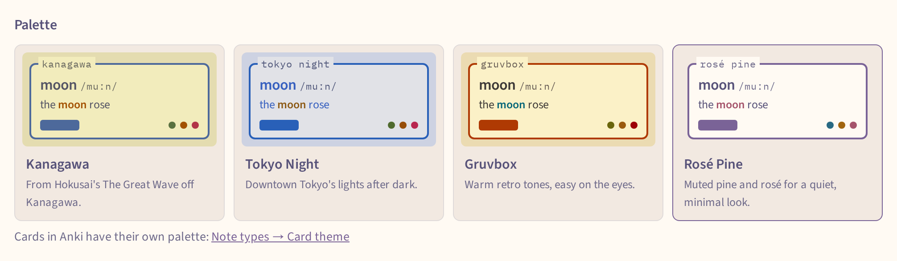

# AnkiNote

<p align="center">
  <picture>
    <source media="(prefers-color-scheme: dark)" srcset="docs/brand/mark-dark.svg">
    
  </picture>
</p>

<p align="center">
  <strong>Convierte cualquier palabra, frase o problema STEM en una tarjeta Anki lista para repasar en segundos.</strong>
</p>

<p align="center">
  <a href="https://pypi.org/project/ankinote-ai/"></a>
  <a href="https://pypi.org/project/ankinote-ai/"></a>
  <a href="https://github.com/ankinote-ai/ankinote/blob/main/LICENSE"></a>
  <a href="https://codecov.io/gh/ankinote-ai/ankinote"></a>
</p>

<p align="center">
  <a href="README.md">English</a> | <a href="README.zh-CN.md">简体中文</a> | <a href="README.zh-Hant.md">繁體中文</a> | <a href="README.ja.md">日本語</a> | <strong>Español</strong> | <a href="README.fr.md">Français</a>
</p>

---

<p align="center">
  
</p>

Crear buenas tarjetas de Anki no debería llevar más tiempo que repasarlas. **AnkiNote** es un estudio de tarjetas Anki impulsado por IA que transforma una palabra, expresión, oración o problema STEM en una tarjeta completa y estilizada — con definiciones, ejemplos, reglas mnemotécnicas, ilustraciones y audio natural — y la guarda directamente en tu Anki.

Sin formato manual. Sin copiar y pegar entre ChatGPT y Anki. Usa tu propia clave API, ejecútalo donde quieras y repasa desde tu móvil, tablet u ordenador.

---

## ✨ ¿Por qué AnkiNote?

- **Funciona con el Anki que ya tienes** — En el ordenador donde estudias, las tarjetas entran directamente en Anki de escritorio mediante el complemento AnkiConnect: sin una segunda colección, sin descargas previas, y Anki las sincroniza como siempre. En un servidor doméstico o NAS siempre encendido, AnkiNote puede usar su propio Anki integrado y sincronizar con AnkiWeb, para añadir tarjetas desde el navegador del móvil con el ordenador apagado.
- **Configuración con una sola clave** — Pega una clave de Gemini AI Studio y el asistente inicial de 5 pasos configurará texto, imágenes y voz automáticamente. También puedes combinar OpenAI, Claude, DeepSeek, fal.ai, Google Cloud TTS o cualquier endpoint compatible con OpenAI.
- **4 modos de tarjeta: Palabra, Frase, Oración y STEM**
  - **Aprendizaje de idiomas**: Definiciones, ejemplos reales, trucos de memoria, ilustraciones generadas por IA y audio TTS. Compatible con **inglés, francés, español, alemán, japonés, chino (simplificado y tradicional, con anotaciones ruby/pinyin) y coreano (beta)**.
  - **STEM y resolución de problemas**: Escribe un enunciado o **sube una foto del problema** para generar una tarjeta con explicación paso a paso, fórmulas MathJax y diagramas opcionales.
- **Vista previa en vivo, edición directa y reescritura con IA** — Voltea anverso/reverso y alterna entre modo claro/oscuro antes de guardar. Edita cualquier campo directamente, pide a la IA que reescriba una explicación STEM o corrige fórmulas LaTeX rotas en un clic (con deshacer).
- **Temas visuales cuidados** — Elige entre **Rosé Pine**, **Kanagawa**, **Tokyo Night** y **Gruvbox** (modos claro y oscuro), adaptados a escritorio y móvil.
- **Funciona con tu agente de IA** — Con la CLI `ankinote`, Claude Code, Codex o cualquier agente que pueda ejecutar comandos convierte lo que estás leyendo en tarjetas.

---

## 📸 Galería de tarjetas e interfaz

<table>
  <tr>
    <td width="50%" valign="top" align="center"><br><sub>Tarjeta de idioma: definición, ilustración y ejemplos</sub></td>
    <td width="50%" valign="top" align="center"><br><sub>Tarjeta STEM: fórmulas y solución paso a paso</sub></td>
  </tr>
</table>

<p align="center">
  <picture>
    <source media="(prefers-color-scheme: dark)" srcset="docs/img/themes-dark.png">
    
  </picture>
</p>

---

## 🚀 Inicio rápido (1 minuto)

El único requisito es [uv](https://docs.astral.sh/uv/getting-started/installation/) (gestiona Python automáticamente):

```bash
curl -LsSf https://astral.sh/uv/install.sh | sh
```

Ejecuta AnkiNote directamente sin instalarlo:

```bash
uvx --from ankinote-ai ankinote-web
```

Abre **<http://127.0.0.1:8000>** en tu navegador. En el primer arranque, el **asistente de configuración** te guiará paso a paso:

1. **Proveedor de IA** — Pega tu clave de Gemini (cubre texto, imagen y voz) o abre **Avanzado** para OpenAI, Claude, DeepSeek, fal.ai o endpoints personalizados.
2. **Conexión con Anki** — Abre Anki de escritorio con el complemento [AnkiConnect](https://ankiweb.net/shared/info/2055492159) instalado; el asistente lo detecta y crea los tipos de nota. *(En un servidor sin Anki de escritorio, elige **Anki integrado** e inicia sesión en AnkiWeb.)*
3. **Idiomas** — Selecciona tu idioma nativo y el idioma objetivo.
4. **Apariencia** — Elige la paleta de colores y el modo claro u oscuro; tus tarjetas de Anki usan la misma paleta.
5. **Primera tarjeta** — Genera y guarda tu primera tarjeta sin salir del asistente.

<table>
  <tr>
    <td width="50%" valign="top" align="center"><br><sub>Asistente de configuración, paso 1: conectar un modelo de IA</sub></td>
    <td width="50%" valign="top" align="center"><br><sub>Asistente de configuración, paso 2: conectar Anki</sub></td>
  </tr>
</table>

Para instalarlo de forma permanente:

```bash
uv tool install ankinote-ai
ankinote-web
```

> **Nota:** En Linux, `ankinote-ai` requiere `glibc >= 2.35` (Ubuntu 22.04+, Debian 12+ o similar). También compatible con macOS 12+ y Windows.

---

## 🐳 Autoalojamiento con Docker

Ejecuta AnkiNote 24/7 en un servidor doméstico o NAS para crear tarjetas desde el móvil en cualquier momento, incluso con el ordenador apagado. En el ordenador donde usas Anki no necesitas Docker: basta con el Inicio rápido de arriba. Imágenes multi-arquitectura (`amd64` + `arm64`) disponibles en `ghcr.io/ankinote-ai/ankinote` e `ignity21/ankinote-ai`.

```bash
# Anki integrado + sincronización AnkiWeb, sin app de escritorio
cd deploy/headless
cp .env.example .env      # opcional: ANKIWEB_USERNAME / ANKIWEB_PASSWORD, puerto, etc.
docker compose up -d      # abre http://localhost:8080
```

Para que el contenedor use un Anki de escritorio con AnkiConnect, usa `deploy/standard`. AnkiNote no tiene inicio de sesión: úsalo en tu red doméstica o en una red privada como Tailscale, y no lo expongas a internet salvo detrás de un proxy inverso que pida inicio de sesión. Consulta [`deploy/README.md`](deploy/README.md) para ver todas las opciones.

---

## ⌨️ Desde la terminal o un agente de IA

El comando `ankinote` crea tarjetas sin abrir el navegador y usa los mismos ajustes que la app web. Por eso cualquier agente de IA que pueda ejecutar comandos (Claude Code, Codex, …) puede usarlo por ti.

**Desde una foto de lo que estás leyendo.** Fotografía una página donde subrayaste palabras nuevas y dile a tu agente: *«Haz tarjetas de Anki con las palabras subrayadas.»* Lee la imagen, extrae las palabras y ejecuta:

```bash
ankinote word batch serendipity ephemeral eloquent
```

**Desde una lista que ya tienes.** Una palabra por línea:

```bash
ankinote word batch --file words.txt --rpm 30
```

Las tarjetas de la CLI van directamente a Anki, sin vista previa. Para revisar cada una antes de guardarla, pega la misma lista en la página Generar de la app web.

Ejecuta `ankinote` solo para abrir un menú en la terminal. La [Guía de uso de la CLI](docs/cli-usage.md) cubre frases, oraciones, STEM y todas las opciones.

---

## 🤖 Proveedores compatibles

| Capacidad | Preajustes y compatibilidad |
| --- | --- |
| **Generación de texto** | Gemini, OpenAI, Claude, DeepSeek o cualquier endpoint compatible con OpenAI (vía `litellm`) |
| **Generación de imágenes** | Gemini, OpenAI (`gpt-image`), fal.ai |
| **Texto a voz (TTS)** | Gemini TTS, OpenAI TTS, Google Cloud TTS |

Todas las claves y ajustes se quedan en tu equipo, en `~/.config/ankinote/settings.json`.

---

## 🛠️ Desarrollo

```bash
git clone https://github.com/ankinote-ai/ankinote.git
cd ankinote-ai

uv sync                   # instalar dependencias Python (Python 3.14+)
make web-dev              # servidor de desarrollo Svelte + Vite
uv run ankinote-web       # servidor backend FastAPI

make test                 # ejecutar tests con pytest
make format               # formatear con ruff
make check                # lint y comprobación de tipos (ruff + ty)
```

---

## 📚 Documentación

- [Guía de uso de la CLI](docs/cli-usage.md)
- [Guía de despliegue con Docker](deploy/README.md)
- [Referencia de tipos de nota](docs/NoteType.org)
- [Agent Skill](.agents/skills/ankinote-cli/SKILL.md) — para usar AnkiNote con asistentes de programación IA

## 📄 Licencia

Licencia MIT — consulta el archivo [LICENSE](LICENSE) para más detalles.
