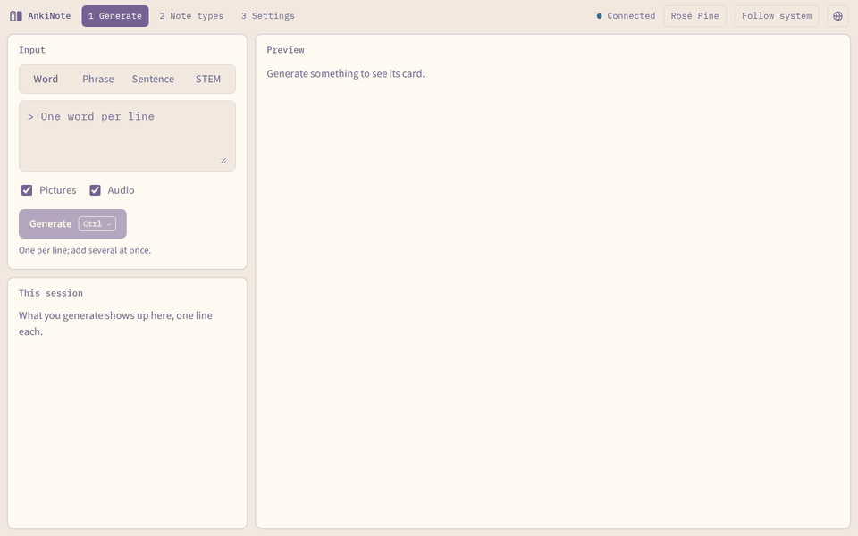
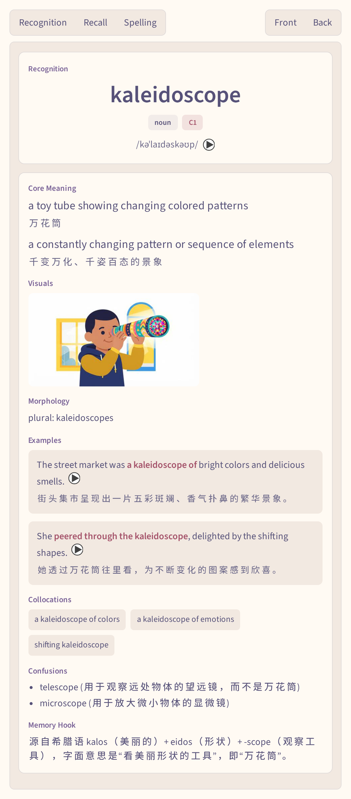
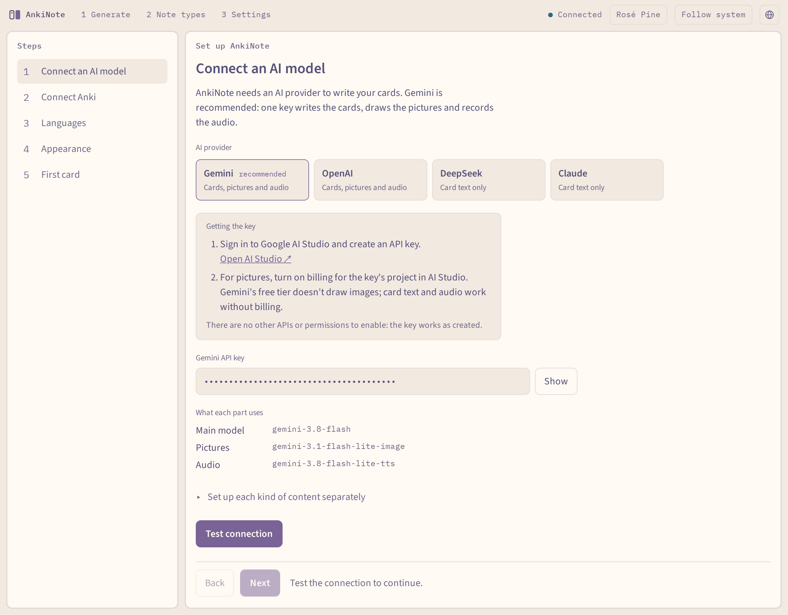
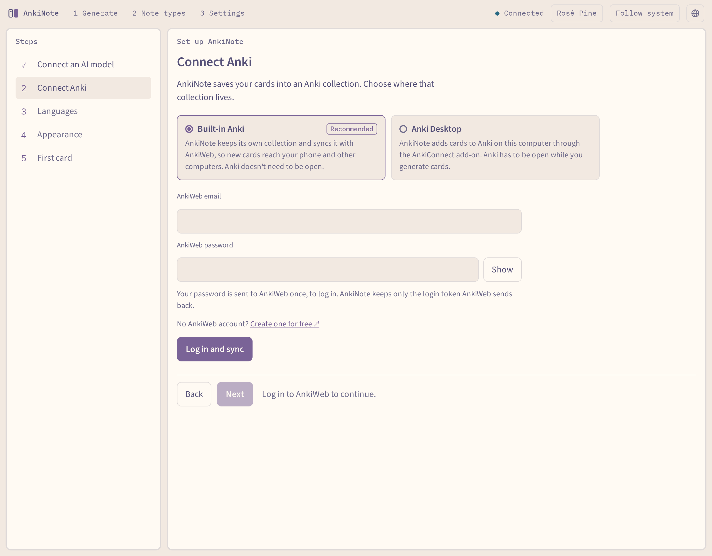

# AnkiNote

<p align="center">
  <picture>
    <source media="(prefers-color-scheme: dark)" srcset="docs/brand/mark-dark.svg">
    
  </picture>
</p>

<p align="center">
  <strong>Convierte cualquier palabra, frase o problema STEM en una tarjeta Anki lista para repasar en segundos.</strong>
</p>

<p align="center">
  <a href="https://pypi.org/project/ankinote-ai/"></a>
  <a href="https://pypi.org/project/ankinote-ai/"></a>
  <a href="https://github.com/ankinote-ai/ankinote/blob/main/LICENSE"></a>
  <a href="https://codecov.io/gh/ankinote-ai/ankinote"></a>
</p>

<p align="center">
  <a href="README.md">English</a> | <a href="README.zh-CN.md">简体中文</a> | <a href="README.zh-Hant.md">繁體中文</a> | <a href="README.ja.md">日本語</a> | <strong>Español</strong> | <a href="README.fr.md">Français</a>
</p>

---

<p align="center">
  
</p>

Crear buenas tarjetas de Anki no debería llevar más tiempo que repasarlas. **AnkiNote** es un estudio de tarjetas Anki impulsado por IA que transforma una palabra, expresión, oración o problema STEM en una tarjeta completa y estilizada — con definiciones, ejemplos, reglas mnemotécnicas, ilustraciones y audio natural — y la guarda directamente en tu Anki.

Sin formato manual. Sin copiar y pegar entre ChatGPT y Anki. Usa tu propia clave API, ejecútalo donde quieras y repasa desde tu móvil, tablet u ordenador.

---

## ✨ ¿Por qué AnkiNote?

- **Funciona con el Anki que ya tienes** — Guarda tarjetas directamente en Anki de escritorio mediante AnkiConnect sin duplicar tu colección, o usa el Anki integrado con sincronización AnkiWeb en un servidor doméstico/NAS para crear tarjetas desde el móvil.
- **Configuración con una sola clave** — Pega una clave de Gemini en el asistente de 5 pasos para configurar texto, imágenes y voz, o combina los proveedores que prefieras.
- **4 modos de tarjeta: Palabra, Frase, Oración y STEM**
  - **Aprendizaje de idiomas**: Definiciones, ejemplos reales, trucos de memoria, ilustraciones IA y audio TTS en **inglés, francés, español, alemán, japonés, chino (simplificado y tradicional, con ruby/pinyin) y coreano (beta)** — en cualquier par de idiomas.
  - **STEM y resolución de problemas**: Escribe un enunciado o **arrastra la foto de un problema** para generar una tarjeta paso a paso con fórmulas MathJax y diagramas opcionales.
- **Vista previa en vivo, edición directa y reescritura con IA** — Voltea anverso/reverso y alterna claro/oscuro antes de guardar; edita campos al vuelo, pide a la IA que reescriba una explicación STEM o corrige LaTeX roto en un clic (con deshacer).
- **Temas visuales cuidados** — **Rosé Pine**, **Kanagawa**, **Tokyo Night** y **Gruvbox** en modos claro y oscuro, adaptados a escritorio y móvil.
- **Listo para CLI y agentes de IA** — Usa la CLI `ankinote` desde la terminal o deja que Claude Code, Codex u otros agentes conviertan tus lecturas en tarjetas.

---

## 📸 Galería de tarjetas e interfaz

<table>
  <tr>
    <td width="50%" valign="top" align="center"><br><sub>Tarjeta de idioma: definición, ilustración y ejemplos</sub></td>
    <td width="50%" valign="top" align="center"><br><sub>Tarjeta STEM: fórmulas y solución paso a paso</sub></td>
  </tr>
</table>

<p align="center">
  <picture>
    <source media="(prefers-color-scheme: dark)" srcset="docs/img/themes-dark.png">
    
  </picture>
</p>

---

## 🚀 Inicio rápido (1 minuto)

El único requisito es [uv](https://docs.astral.sh/uv/getting-started/installation/) (gestiona Python automáticamente):

```bash
curl -LsSf https://astral.sh/uv/install.sh | sh
```

Ejecuta AnkiNote directamente sin instalarlo (arranca siempre la última versión):

```bash
uvx --from ankinote-ai@latest ankinote-web
```

Abre **<http://127.0.0.1:8000>** en tu navegador. En el primer arranque, el **asistente de configuración** te guiará paso a paso:

1. **Proveedor de IA** — Pega tu clave de Gemini (cubre texto, imagen y voz) o abre **Avanzado** para OpenAI, Claude, DeepSeek, fal.ai o endpoints personalizados.
2. **Conexión con Anki** — Abre Anki de escritorio con el complemento [AnkiConnect](https://ankiweb.net/shared/info/2055492159) instalado; el asistente lo detecta y crea los tipos de nota. *(En un servidor sin Anki de escritorio, elige **Anki integrado** e inicia sesión en AnkiWeb.)*
3. **Idiomas** — Selecciona tu idioma nativo y el idioma objetivo.
4. **Apariencia** — Elige la paleta de colores y el modo claro u oscuro; tus tarjetas de Anki usan la misma paleta.
5. **Primera tarjeta** — Genera y guarda tu primera tarjeta sin salir del asistente.

<table>
  <tr>
    <td width="50%" valign="top" align="center"><br><sub>Asistente de configuración, paso 1: conectar un modelo de IA</sub></td>
    <td width="50%" valign="top" align="center"><br><sub>Asistente de configuración, paso 2: conectar Anki</sub></td>
  </tr>
</table>

Para instalarlo de forma permanente:

```bash
uv tool install ankinote-ai
ankinote-web
```

> [!NOTE]
> - **Requisitos:** En Linux, `ankinote-ai` requiere `glibc >= 2.35` (Ubuntu 22.04+, Debian 12+ o similar). También compatible con macOS 12+ y Windows.
> - **Actualizaciones:** Sea cual sea la instalación, AnkiNote consulta PyPI al arrancar y una vez al día, mostrando el comando de actualización en **Ajustes → Acerca de**. Define `ANKINOTE_UPDATE_CHECK=0` para desactivarlo.

---

## 🐳 Autoalojamiento con Docker

Ejecuta AnkiNote 24/7 en un servidor doméstico o NAS para crear tarjetas desde el móvil en cualquier momento, incluso con el ordenador apagado. En el ordenador donde usas Anki no necesitas Docker: basta con el Inicio rápido de arriba. Imágenes multi-arquitectura (`amd64` + `arm64`) disponibles en `ghcr.io/ankinote-ai/ankinote` e `ignity21/ankinote-ai`.

```bash
# Anki integrado + sincronización AnkiWeb, sin app de escritorio
cd deploy/headless
cp .env.example .env      # opcional: ANKIWEB_USERNAME / ANKIWEB_PASSWORD, puerto, etc.
docker compose up -d      # abre http://localhost:8080
```

Para que el contenedor use un Anki de escritorio con AnkiConnect, usa `deploy/standard`. Consulta [`deploy/README.md`](deploy/README.md) para ver todas las opciones de despliegue, consejos de proxy inverso y guías de migración.

> [!IMPORTANT]
> - **Sin inicio de sesión integrado:** Mantén AnkiNote en tu red doméstica o en una red privada como Tailscale; no lo expongas a internet salvo detrás de un proxy inverso con autenticación.
> - **Nombres de host personalizados (`ANKINOTE_ALLOWED_HOSTS`):** Por defecto solo responde a `localhost` y direcciones IP. Si accedes mediante un nombre de host (proxy inverso o Tailscale), añádelo separado por comas en `ANKINOTE_ALLOWED_HOSTS` — incluso si el proxy reenvía a una IP — o guardar, sincronizar y listar modelos fallará con `403`.

---

## ⌨️ Desde la terminal o un agente de IA

El comando `ankinote` crea tarjetas sin abrir el navegador y usa los mismos ajustes que la app web. Por eso cualquier agente de IA que pueda ejecutar comandos (Claude Code, Codex, …) puede usarlo por ti.

**Desde una foto de lo que estás leyendo.** Fotografía una página donde subrayaste palabras nuevas y dile a tu agente: *«Haz tarjetas de Anki con las palabras subrayadas.»* Lee la imagen, extrae las palabras y ejecuta:

```bash
ankinote word batch serendipity ephemeral eloquent
```

**Desde una lista que ya tienes.** Una palabra por línea:

```bash
ankinote word batch --file words.txt --rpm 30
```

Las tarjetas de la CLI van directamente a Anki, sin vista previa. Para revisar cada una antes de guardarla, pega la misma lista en la página Generar de la app web.

Ejecuta `ankinote` solo para abrir un menú en la terminal. La [Guía de uso de la CLI](docs/cli-usage.md) cubre frases, oraciones, STEM y todas las opciones. Para enseñarle estos comandos a tu agente, ejecuta una vez `ankinote skill install` (y de nuevo tras actualizar).

---

## 💡 Flujos de trabajo prácticos

Más allá de buscar palabras sueltas, dos flujos de trabajo agilizan mucho el estudio diario:

### Aprende una palabra en la frase donde la encontraste

Pega una frase de un artículo o libro en **Generar** y pon entre corchetes la palabra (o cada parte de una expresión). Las líneas sin corchetes siguen siendo palabras sueltas, así que ambos pueden ir en el mismo lote:

```text
We sat on the [bank] of the river.
I'll [pick] you [up] at six.
```

- **Un solo sentido, sin relleno** — Explica solo el significado usado en esa frase ("bank" como orilla, no todas las acepciones del diccionario).
- **Tu frase queda como primer ejemplo** — Repasas la palabra palabra por palabra en el contexto donde la encontraste.
- **Cualquier forma, cualquier idioma** — Marca la forma que viste (`ran`, `食べた`, o el alemán `Ich [rufe] dich [an]`); la tarjeta devuelve la forma de diccionario.

### Convierte un problema STEM que fallaste en una tarjeta

Haz una foto a un problema de deberes o examen, cambia **Generar** a **STEM** y pega o arrastra la imagen (elige **Problema** o déjalo en **Auto**):

- **Tu problema exacto, autosuficiente** — Redacta el enunciado en el anverso para entenderse sin la imagen, con la respuesta final y la solución paso a paso en el reverso.
- **Cómo llegar al método** — Señala la pista del enunciado que orienta hacia la estrategia de resolución, no solo el álgebra.
- **Revisa antes de guardar** — La vista previa muestra MathJax; ajusta pasos con **Editar campos** o repara fórmulas con **Corregir con IA**. *(Requiere un modelo principal que acepte imágenes, como el modelo Gemini recomendado.)*

---

## 🤖 Proveedores compatibles

| Capacidad | Preajustes y compatibilidad |
| --- | --- |
| **Generación de texto** | Gemini, OpenAI, Claude, DeepSeek o cualquier endpoint compatible con OpenAI (vía `litellm`) |
| **Generación de imágenes** | Gemini, OpenAI (`gpt-image`), fal.ai |
| **Texto a voz (TTS)** | Gemini TTS, OpenAI TTS, Google Cloud TTS |

Todas las claves y ajustes se quedan en tu equipo, en `~/.config/ankinote/settings.json`.

> [!NOTE]
> Google Cloud TTS requiere su propia clave de Google Cloud (restringida a la API Cloud Text-to-Speech) y tener la facturación activada en el proyecto incluso dentro de la cuota mensual gratuita; una clave de AI Studio solo sirve para la API de Gemini. El asistente detalla los pasos en *Configurar cada contenido por separado*.

---

## 🛠️ Desarrollo

```bash
git clone https://github.com/ankinote-ai/ankinote.git
cd ankinote

uv sync                   # instalar dependencias Python (Python 3.14+)
make web-dev              # servidor de desarrollo Svelte + Vite
uv run ankinote-web       # servidor backend FastAPI

make test                 # ejecutar tests con pytest
make format               # formatear con ruff
make check                # lint y comprobación de tipos (ruff + ty)
```

---

## 📚 Documentación

- [Guía de uso de la CLI](docs/cli-usage.md)
- [Guía de despliegue con Docker](deploy/README.md)
- [Referencia de tipos de nota](docs/NoteType.org)
- [Agent Skill](src/ankinote/skills/ankinote-cli/SKILL.md) — para usar AnkiNote con asistentes de programación IA

## 📄 Licencia

Licencia MIT — consulta el archivo [LICENSE](LICENSE) para más detalles.
