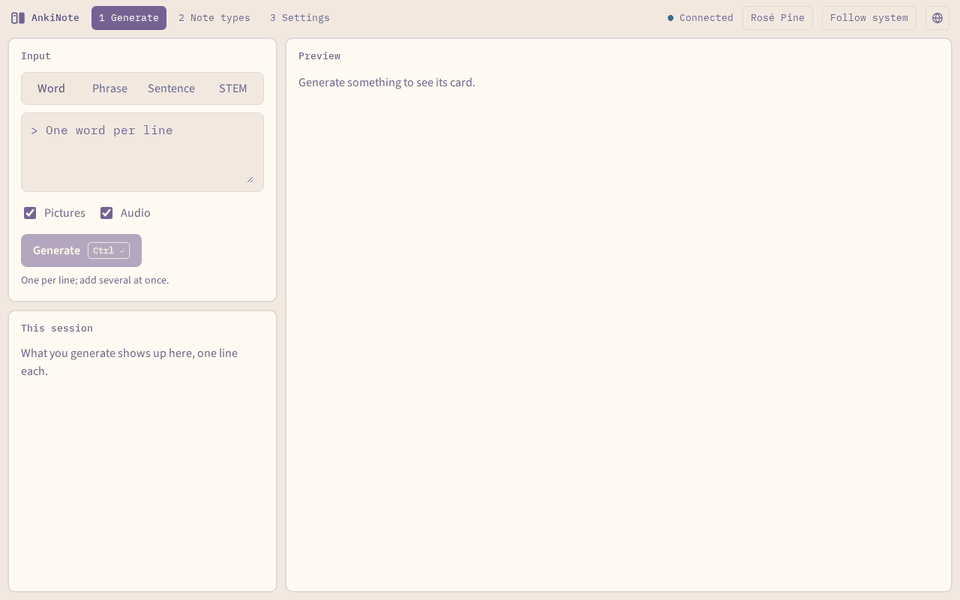
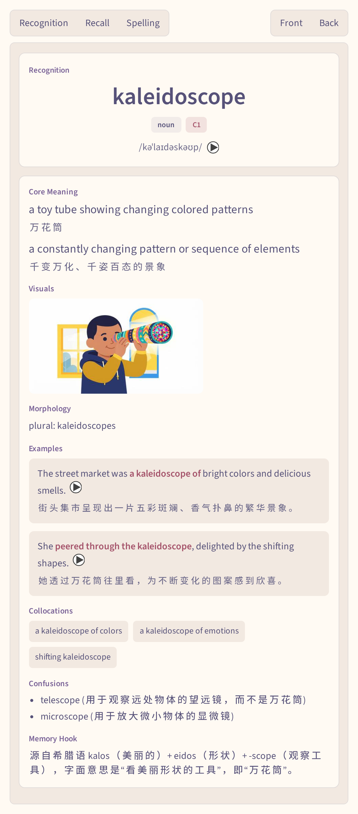
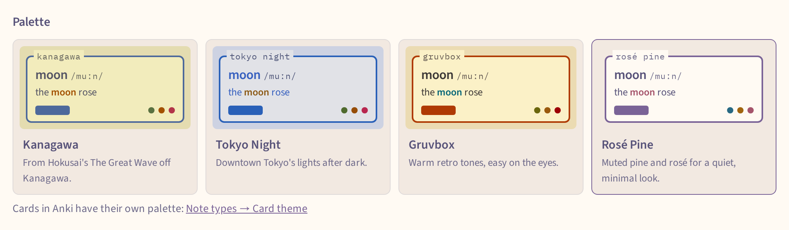
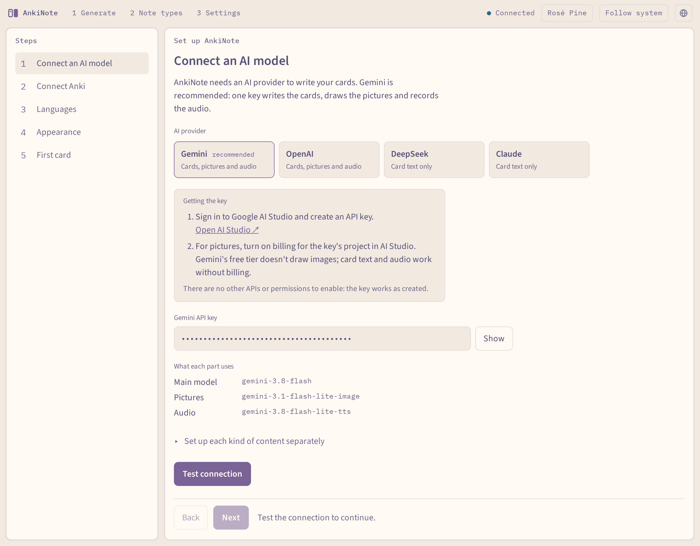
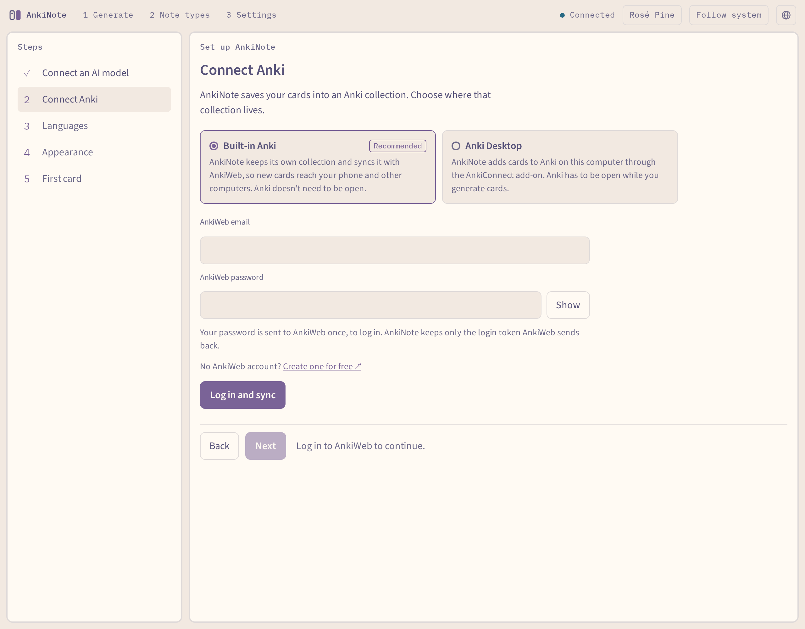

# AnkiNote

<p align="center">
  <picture>
    <source media="(prefers-color-scheme: dark)" srcset="docs/brand/mark-dark.svg">
    
  </picture>
</p>

<p align="center">
  <strong>Transformez n'importe quel mot, phrase ou problème STEM en une carte Anki prête à réviser en quelques secondes.</strong>
</p>

<p align="center">
  <a href="https://pypi.org/project/ankinote-ai/"></a>
  <a href="https://pypi.org/project/ankinote-ai/"></a>
  <a href="https://github.com/ankinote-ai/ankinote/blob/main/LICENSE"></a>
  <a href="https://codecov.io/gh/ankinote-ai/ankinote"></a>
</p>

<p align="center">
  <a href="README.md">English</a> | <a href="README.zh-CN.md">简体中文</a> | <a href="README.ja.md">日本語</a> | <a href="README.es.md">Español</a> | <strong>Français</strong>
</p>

---

<p align="center">
  
</p>

Créer de bonnes cartes Anki ne devrait pas prendre plus de temps que de les réviser. **AnkiNote** est un studio de cartes Anki propulsé par l'IA qui transforme un mot, une expression, une phrase ou un problème STEM en une carte complète et soignée — avec définitions, exemples, moyens mnémotechniques, illustrations et audio naturel — puis la synchronise directement avec votre compte AnkiWeb.

Fini la mise en forme manuelle et les copier-coller entre ChatGPT et Anki. Utilisez votre propre clé API, hébergez-le où vous voulez et révisez sur téléphone, tablette ou ordinateur.

---

## ✨ Pourquoi AnkiNote ?

- **Anki intégré & synchronisation AnkiWeb** — Aucun besoin d'ouvrir Anki Desktop ni AnkiConnect. AnkiNote embarque le moteur Anki et se synchronise automatiquement avec AnkiWeb : les cartes créées depuis un navigateur ou un NAS apparaissent sur tous vos appareils. *(AnkiConnect reste pris en charge si vous utilisez déjà Anki Desktop.)*
- **Configuration en une seule clé** — Collez une clé Gemini AI Studio et l'assistant en 5 étapes configure automatiquement le texte, les images et la voix. Vous pouvez aussi combiner OpenAI, Claude, DeepSeek, fal.ai, Google Cloud TTS ou tout endpoint compatible OpenAI.
- **4 modes de cartes : Mot, Expression, Phrase et STEM**
  - **Apprentissage des langues** : Définitions, exemples authentiques, astuces mnémotechniques, illustrations générées par IA et audio TTS. Prend en charge **l'anglais, le français, l'espagnol, l'allemand, le japonais, le chinois (simplifié et traditionnel, avec annotations ruby/pinyin) et le coréen (bêta)**.
  - **STEM & résolution de problèmes** : Saisissez un énoncé ou **importez la photo d'un exercice** pour obtenir une carte structurée avec explication étape par étape, formules MathJax et schémas optionnels.
- **Aperçu en direct, édition directe & réécriture IA** — Retournez le recto/verso et basculez entre mode clair et sombre avant d'enregistrer. Modifiez n'importe quel champ directement, demandez à l'IA de réécrire une explication STEM ou réparez les formules LaTeX cassées en un clic (avec annulation).
- **Thèmes de cartes soignés** — Choisissez parmi **Rosé Pine**, **Kanagawa**, **Tokyo Night** et **Gruvbox** en modes clair et sombre, adaptés au bureau comme au mobile.
- **Fonctionne avec votre agent IA** — Grâce à la CLI `ankinote`, Claude Code, Codex ou tout agent capable d'exécuter des commandes transforme ce que vous lisez en cartes.

---

## 📸 Aperçu des cartes et de l'interface

<table>
  <tr>
    <td width="50%" valign="top" align="center"><br><sub>Carte de langue : définition, illustration et exemples</sub></td>
    <td width="50%" valign="top" align="center"><br><sub>Carte STEM : formules et solution pas à pas</sub></td>
  </tr>
</table>

<p align="center">
  <picture>
    <source media="(prefers-color-scheme: dark)" srcset="docs/img/themes-dark.png">
    
  </picture>
</p>

---

## 🚀 Démarrage rapide (1 minute)

Le seul prérequis est [uv](https://docs.astral.sh/uv/getting-started/installation/) (il gère Python automatiquement) :

```bash
curl -LsSf https://astral.sh/uv/install.sh | sh
```

Lancez AnkiNote directement sans installation :

```bash
uvx --from ankinote-ai ankinote-web
```

Ouvrez **<http://127.0.0.1:8000>** dans votre navigateur. Au premier lancement, **l'assistant de configuration** vous guide :

1. **Fournisseur IA** — Collez une clé Gemini (texte, image et voix inclus) ou ouvrez **Avancé** pour OpenAI, Claude, DeepSeek, fal.ai ou des endpoints personnalisés.
2. **Connexion Anki** — Choisissez **Anki intégré** et connectez-vous à AnkiWeb *(ou choisissez **AnkiConnect** avec Anki Desktop)*.
3. **Langues** — Sélectionnez votre langue maternelle et la langue cible.
4. **Apparence** — Choisissez la palette de couleurs et le mode clair ou sombre ; vos cartes Anki adoptent la même palette.
5. **Première carte** — Générez et enregistrez votre première carte directement depuis l'assistant.

<table>
  <tr>
    <td width="50%" valign="top" align="center"><br><sub>Assistant de configuration, étape 1 : connecter un modèle d'IA</sub></td>
    <td width="50%" valign="top" align="center"><br><sub>Assistant de configuration, étape 2 : connecter Anki</sub></td>
  </tr>
</table>

Pour l'installer globalement :

```bash
uv tool install ankinote-ai
ankinote-web
```

> **Note :** Sous Linux, `ankinote-ai` requiert `glibc >= 2.35` (Ubuntu 22.04+, Debian 12+ ou équivalent). Compatible également avec macOS 12+ et Windows.

---

## 🐳 Auto-hébergement avec Docker

Hébergez AnkiNote 24h/24 sur un serveur, VPS ou NAS pour créer des cartes depuis votre téléphone à tout moment. Images multi-arch (`amd64` + `arm64`) publiées sur `ghcr.io/ankinote-ai/ankinote` et `ignity21/ankinote-ai`.

```bash
# Mode autonome (recommandé : Anki intégré + synchro AnkiWeb)
cd deploy/headless
cp .env.example .env      # optionnel : ANKIWEB_USERNAME / ANKIWEB_PASSWORD, port, etc.
docker compose up -d      # ouvrez http://localhost:8080
```

Si vous utilisez déjà Anki Desktop avec AnkiConnect, utilisez `deploy/standard`. Consultez [`deploy/README.md`](deploy/README.md) pour tous les détails.

---

## ⌨️ Depuis le terminal ou un agent IA

La commande `ankinote` crée des cartes sans ouvrir le navigateur et utilise les mêmes réglages que l'application web. N'importe quel agent IA capable d'exécuter des commandes (Claude Code, Codex, …) peut donc s'en servir pour vous.

**À partir d'une photo de votre lecture.** Photographiez une page où vous avez souligné des mots nouveaux et dites à votre agent : *« Fais des cartes Anki avec les mots soulignés. »* Il lit l'image, repère les mots et exécute :

```bash
ankinote word batch serendipity ephemeral eloquent
```

**À partir d'une liste existante.** Un mot par ligne :

```bash
ankinote word batch --file words.txt --rpm 30
```

Les cartes créées par la CLI vont directement dans Anki, sans aperçu. Pour vérifier chaque carte avant de l'enregistrer, collez plutôt la même liste dans la page Générer de l'application web.

Lancez `ankinote` seul pour ouvrir un menu dans le terminal. Le [Guide d'utilisation CLI](docs/cli-usage.md) couvre expressions, phrases, STEM et toutes les options.

---

## 🤖 Fournisseurs pris en charge

| Capacité | Préréglages et compatibilité |
| --- | --- |
| **Génération de texte** | Gemini, OpenAI, Claude, DeepSeek ou tout endpoint compatible OpenAI (via `litellm`) |
| **Génération d'images** | Gemini, OpenAI (`gpt-image`), fal.ai |
| **Synthèse vocale (TTS)** | Gemini TTS, OpenAI TTS, Google Cloud TTS |

Toutes vos clés API et réglages restent sur votre machine, dans `~/.config/ankinote/settings.json`.

---

## 🛠️ Développement

```bash
git clone https://github.com/ankinote-ai/ankinote.git
cd ankinote-ai

uv sync                   # installer les dépendances Python (Python 3.14+)
make web-dev              # serveur de dev Svelte + Vite
uv run ankinote-web       # serveur backend FastAPI

make test                 # lancer les tests pytest
make format               # formater avec ruff
make check                # lint et vérification des types (ruff + ty)
```

---

## 📚 Documentation

- [Guide d'utilisation CLI](docs/cli-usage.md)
- [Guide de déploiement Docker](deploy/README.md)
- [Référence des types de notes](docs/NoteType.org)
- [Agent Skill](.agents/skills/ankinote-cli/SKILL.md) — pour utiliser AnkiNote avec des assistants de code IA

## 📄 Licence

Licence MIT — voir [LICENSE](LICENSE) pour plus de détails.
