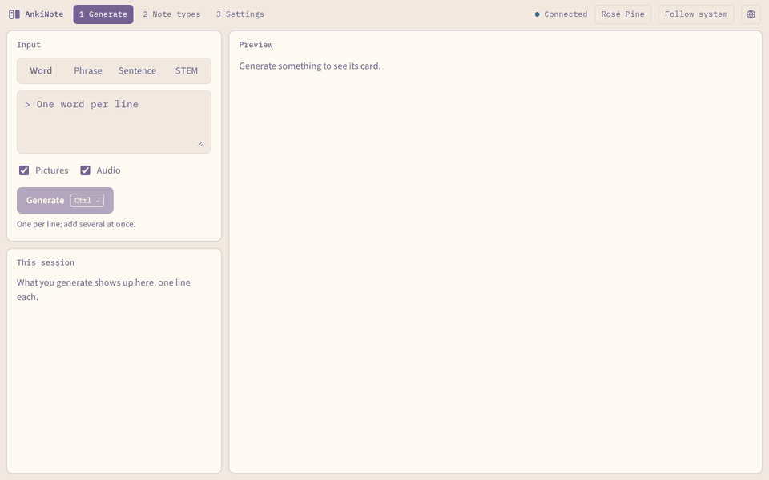
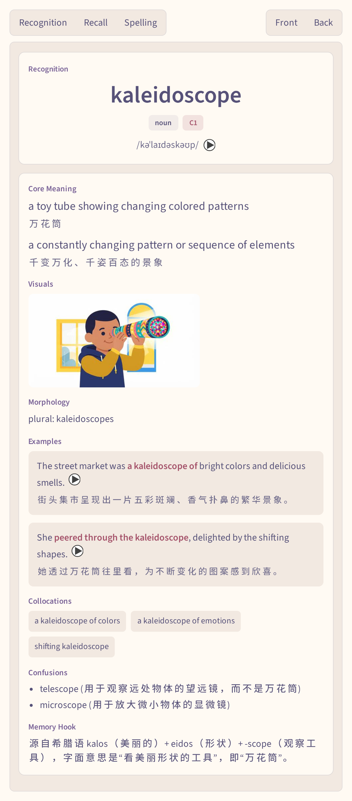
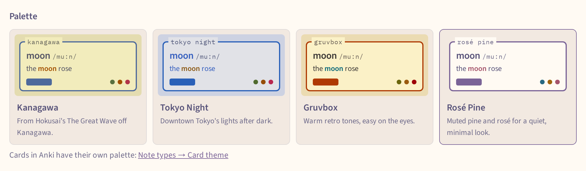
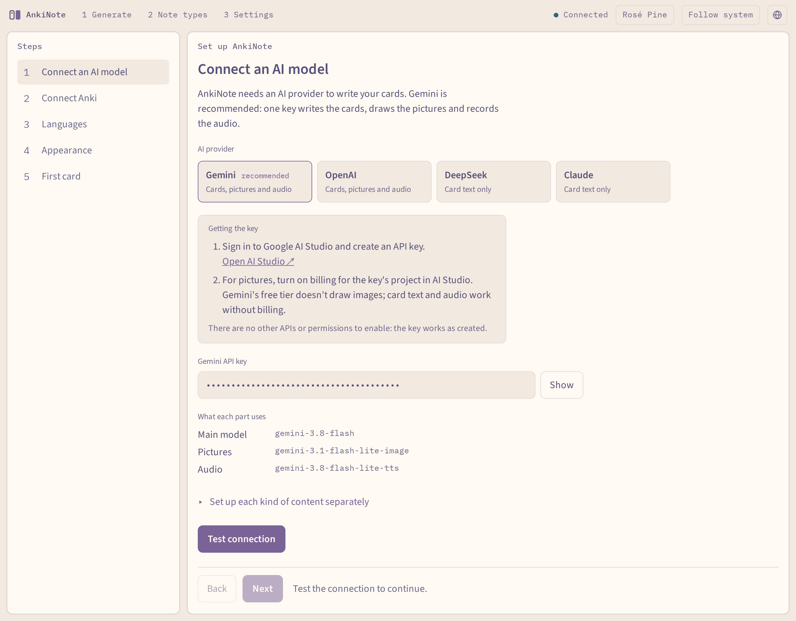
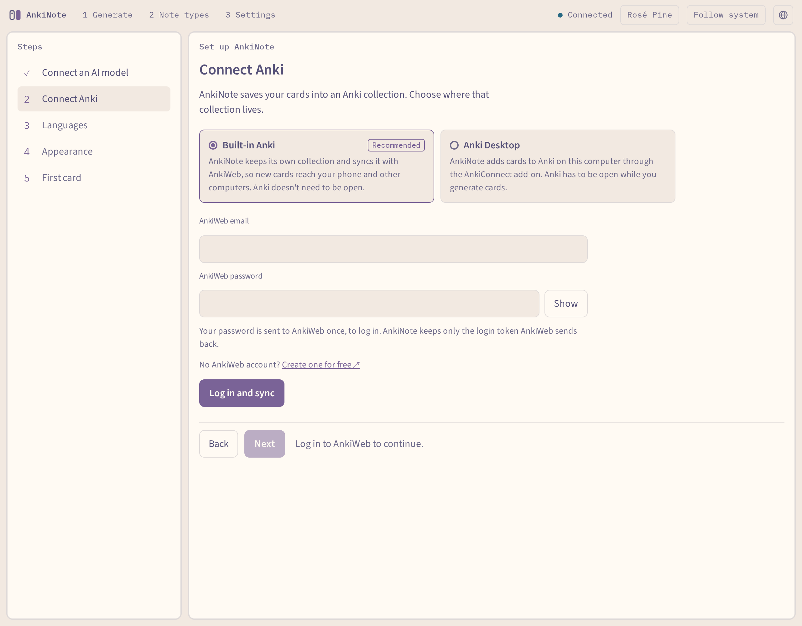

# AnkiNote

<p align="center">
  <picture>
    <source media="(prefers-color-scheme: dark)" srcset="docs/brand/mark-dark.svg">
    
  </picture>
</p>

<p align="center">
  <strong>単語・フレーズ・例文・理系（STEM）問題を、数秒で完成度の高い Anki カードに。</strong>
</p>

<p align="center">
  <a href="https://pypi.org/project/ankinote-ai/"></a>
  <a href="https://pypi.org/project/ankinote-ai/"></a>
  <a href="https://github.com/ignity21/ankinote-ai/blob/main/LICENSE"></a>
  <a href="https://codecov.io/gh/ignity21/ankinote-ai"></a>
</p>

<p align="center">
  <a href="README.md">English</a> | <a href="README.zh-CN.md">简体中文</a> | <strong>日本語</strong> | <a href="README.es.md">Español</a> | <a href="README.fr.md">Français</a>
</p>

---

<p align="center">
  
</p>

カード作りが、復習そのものより大変であってはいけません。**AnkiNote** は、単語・フレーズ・例文・STEM（数学・理科・プログラミング）問題を入力するだけで、解説・例文・語呂合わせ（記憶フック）・AI イラスト・自然な音声を備えた完成品カードを自動生成し、そのまま AnkiWeb に同期できる AI カードスタジオです。

手作業のレイアウト調整も、ChatGPT と Anki の間のコピペも不要。自分の API キーでどこでも動かせ、スマホ・タブレット・PC からすぐに復習できます。

---

## ✨ AnkiNote の特長

- **Anki エンジン内蔵 ＆ AnkiWeb 自動同期** — デスクトップ版 Anki や AnkiConnect は不要です。Anki 本体のライブラリを内蔵し、AnkiWeb と自動で同期するため、ブラウザや NAS から追加したカードが全端末に届きます。*（既存の AnkiConnect 環境にも対応しています。）*
- **API キー 1 つで簡単セットアップ** — 初回起動時の 5 ステップウィザードに Gemini AI Studio のキーを貼るだけで、テキスト・画像・音声（TTS）のルートを一括設定。OpenAI、Claude、DeepSeek、fal.ai、Google Cloud TTS、OpenAI 互換エンドポイントの組み合わせも自由です。
- **4 つのカードモード：単語・フレーズ・例文・STEM**
  - **語学学習**：意味・自然な例文・記憶のヒント・AI 生成イラスト・TTS 音声を作成。**英語・フランス語・スペイン語・ドイツ語・日本語・中国語（簡体字/繁体字・ルビ/ピンイン対応）・韓国語（Beta）** をどの言語からでも相互に学習できます。
  - **STEM 問題演習**：問題文の入力、または**問題の写真・スクリーンショットをアップロード**するだけで、MathJax 数式と図解付きのステップ解説カードを生成します。
- **リアルタイムプレビュー・直接編集・AI リライト** — 保存前に表裏の反転やライト/ダーク表示を確認可能。各フィールドの手動編集はもちろん、STEM 解説の AI リライトや壊れた LaTeX 数式のワンクリック修復（元に戻す機能付き）にも対応しています。
- **洗練されたカードテーマ** — **Rosé Pine**、**Kanagawa**、**Tokyo Night**、**Gruvbox** の 4 種類のカラーパレット（ライト/ダーク両対応）を搭載。
- **AI エージェントから使える** — `ankinote` CLI があれば、Claude Code や Codex などコマンドを実行できるエージェントが、読んでいる内容をカードにしてくれます。

---

## 📸 カード ＆ 画面イメージ

<table>
  <tr>
    <td width="50%" valign="top" align="center"><br><sub>語学カード：定義・イラスト・例文</sub></td>
    <td width="50%" valign="top" align="center"><br><sub>STEM カード：数式とステップごとの解説</sub></td>
  </tr>
</table>

<p align="center">
  <picture>
    <source media="(prefers-color-scheme: dark)" srcset="docs/img/themes-dark.png">
    
  </picture>
</p>

---

## 🚀 1 分でクイックスタート

必要なのは [uv](https://docs.astral.sh/uv/getting-started/installation/) だけです（Python 環境も自動で用意されます）：

```bash
curl -LsSf https://astral.sh/uv/install.sh | sh
```

インストールせずにそのまま起動：

```bash
uvx --from ankinote-ai ankinote-web
```

ブラウザで **<http://127.0.0.1:8000>** を開くと、初回**セットアップウィザード**が案内してくれます：

1. **AI プロバイダー** — Gemini API キーを貼り付けるだけ（テキスト・画像・音声すべてに対応）。**詳細設定**を開けば OpenAI、Claude、DeepSeek、fal.ai なども選択できます。
2. **Anki 連携** — **内蔵 Anki** を選んで AnkiWeb にログインします*（デスクトップ版を使う場合は **AnkiConnect** を選択）*。
3. **言語** — 母語と学習言語を選択します。
4. **外観** — カラーパレットとライト／ダークモードを選択します。Anki のカードにも同じパレットが適用されます。
5. **最初のカード** — ウィザード内で最初のカードを生成して保存できます。

<table>
  <tr>
    <td width="50%" valign="top" align="center"><br><sub>セットアップウィザード 手順 1：AI モデルに接続</sub></td>
    <td width="50%" valign="top" align="center"><br><sub>セットアップウィザード 手順 2：Anki に接続</sub></td>
  </tr>
</table>

コマンドとして恒久インストールする場合：

```bash
uv tool install ankinote-ai
ankinote-web
```

> **動作環境**：Linux では `glibc >= 2.35`（Ubuntu 22.04+、Debian 12+ 等）が必要です。macOS 12+ および Windows にも対応しています。

---

## 🐳 Docker でのセルフホスト

サーバー・VPS・NAS に常駐させれば、外出先からスマホのブラウザでいつでもカードを追加できます。マルチアーキテクチャ（`amd64` + `arm64`）イメージを `ghcr.io/ignity21/ankinote-ai` と `ignity21/ankinote-ai` で公開しています。

```bash
# スタンドアロン構成（推奨：Anki 内蔵 ＋ AnkiWeb 同期）
cd deploy/headless
cp .env.example .env      # 任意：ANKIWEB_USERNAME / ANKIWEB_PASSWORD、ポート等を設定
docker compose up -d      # http://localhost:8080 にアクセス
```

すでに AnkiConnect を起動している場合は `deploy/standard` を利用してください。詳細は [`deploy/README.md`](deploy/README.md) をご覧ください。

---

## ⌨️ ターミナルや AI エージェントから使う

`ankinote` コマンドはブラウザを開かずにカードを作れ、Web アプリと同じ設定を使います。コマンドを実行できる AI エージェント（Claude Code、Codex など）なら、あなたの代わりに使えます。

**読んでいるページの写真から。** 新しい単語に線を引いたページを撮って、エージェントに *「線を引いた単語を Anki カードにして」* と頼むだけ。画像を読み、単語を拾い、次を実行します：

```bash
ankinote word batch serendipity ephemeral eloquent
```

**手元の単語リストから。** 1 行に 1 語：

```bash
ankinote word batch --file words.txt --rpm 30
```

CLI で作ったカードはプレビューなしで Anki に入ります。保存前に 1 枚ずつ確認したいときは、同じリストを Web アプリの生成ページに貼り付けてください。

`ankinote` だけを実行するとターミナルにメニューが開きます。フレーズ・文・STEM と全オプションは [CLI 利用ガイド](docs/cli-usage.md) を参照してください。

---

## 🤖 対応プロバイダー

| 機能 | プリセット ＆ 互換性 |
| --- | --- |
| **テキスト生成** | Gemini、OpenAI、Claude、DeepSeek、その他 OpenAI 互換エンドポイント（`litellm` 経由） |
| **画像生成** | Gemini、OpenAI（`gpt-image`）、fal.ai |
| **音声合成（TTS）** | Gemini TTS、OpenAI TTS、Google Cloud TTS |

API キーと設定はすべて手元のマシン（`~/.config/ankinote/settings.json`）にだけ保存されます。

---

## 🛠️ 開発

```bash
git clone https://github.com/ignity21/ankinote-ai.git
cd ankinote-ai

uv sync                   # Python 依存関係のインストール（Python 3.14+）
make web-dev              # Svelte + Vite フロントエンド開発サーバー起動
uv run ankinote-web       # FastAPI バックエンド起動

make test                 # pytest 実行
make format               # ruff でフォーマット
make check                # リント ＆ 型チェック（ruff + ty）
```

---

## 📚 ドキュメント

- [CLI 利用ガイド](docs/cli-usage.md)
- [Docker デプロイガイド](deploy/README.md)
- [ノートタイプリファレンス](docs/NoteType.org)
- [Agent Skill](.agents/skills/ankinote-cli/SKILL.md) — AI コーディングアシスタントとの連携用

## 📄 ライセンス

MIT License — 詳細は [LICENSE](LICENSE) をご覧ください。
