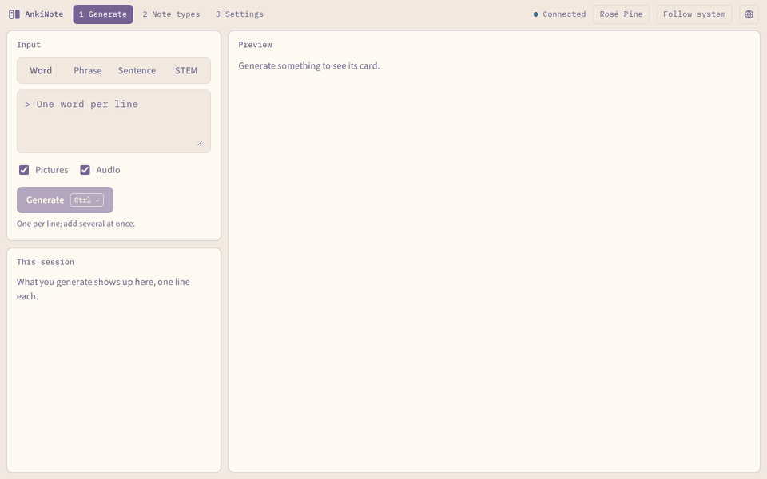
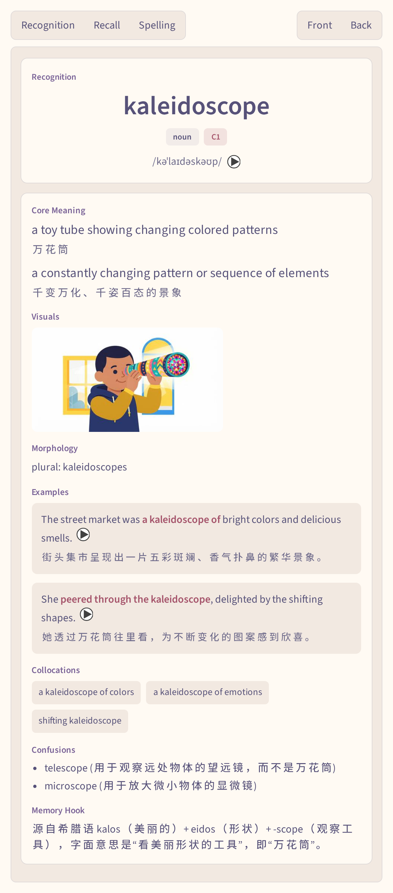
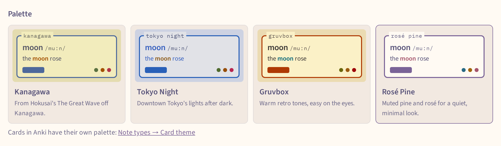
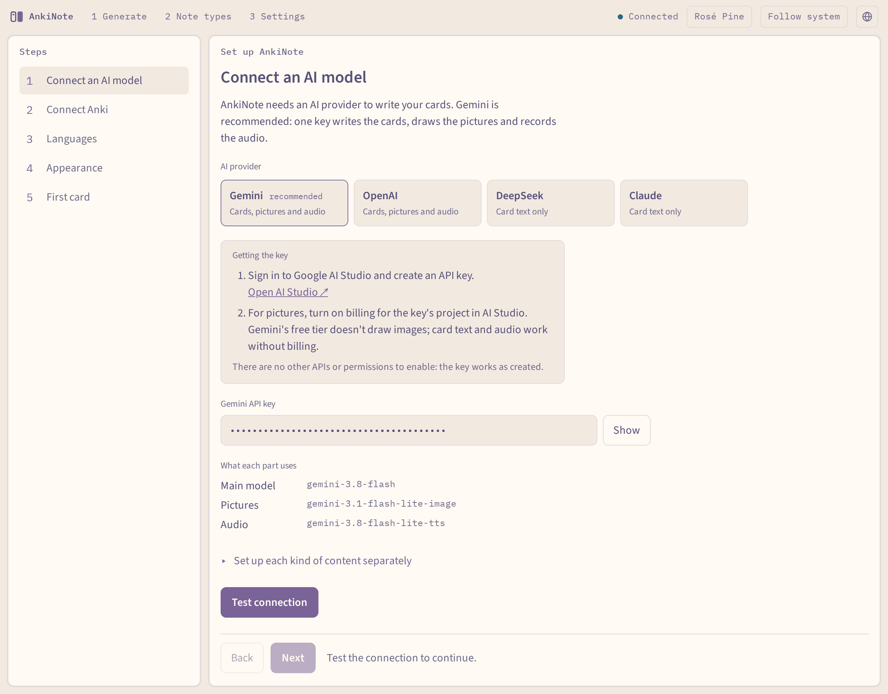
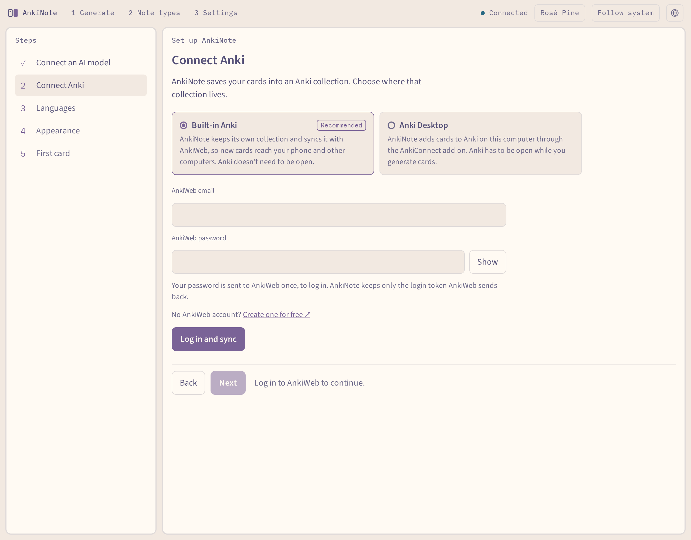

# AnkiNote

<p align="center">
  <picture>
    <source media="(prefers-color-scheme: dark)" srcset="docs/brand/mark-dark.svg">
    
  </picture>
</p>

<p align="center">
  <strong>输入一个单词、句子或 STEM 题目，几秒钟生成可直接复习的精美 Anki 卡片。</strong>
</p>

<p align="center">
  <a href="https://pypi.org/project/ankinote-ai/"></a>
  <a href="https://pypi.org/project/ankinote-ai/"></a>
  <a href="https://github.com/ankinote-ai/ankinote/blob/main/LICENSE"></a>
  <a href="https://codecov.io/gh/ankinote-ai/ankinote"></a>
</p>

<p align="center">
  <a href="README.md">English</a> | <strong>简体中文</strong> | <a href="README.zh-Hant.md">繁體中文</a> | <a href="README.ja.md">日本語</a> | <a href="README.es.md">Español</a> | <a href="README.fr.md">Français</a>
</p>

---

<p align="center">
  
</p>

制卡不该比背卡还累。**AnkiNote** 是一款由 AI 驱动的 Anki 制卡工作台，只需输入一个单词、短语、句子或理工科（STEM）题目，即可自动生成包含释义、例句、助记、AI 配图与自然语音的精美卡片，并直接存进你的 Anki。

告别手动排版，告别在 ChatGPT 和 Anki 之间反复复制粘贴。自带 API Key 即可随时随地运行，在手机、平板和电脑上无缝复习。

---

## ✨ 核心亮点

- **配合你已有的 Anki** — 本地通过 AnkiConnect 直接写入 Anki 桌面版，不额外创建资料库；也可在家用服务器或 NAS 上启用内置 Anki 同步 AnkiWeb，随时用手机浏览器制卡。
- **一个 Key 搞定全部配置** — 5 步配置向导粘贴一个 Gemini API Key 即可同时驱动文本、配图与语音，也支持自由混搭其他服务商。
- **四种制卡模式：单词、短语、句子与 STEM**
  - **语言学习**：精准释义、地道例句、记忆技巧、AI 配图与真人感发音。支持 **英语、法语、西班牙语、德语、日语、中文（简/繁体，带注音/拼音）与韩语（Beta）** 任意互译学习。
  - **STEM 理科解题**：输入题目或**直接拖入题目截图/照片**，生成带 MathJax 公式与辅助示意图的分步解析卡片。
- **实时预览、行内编辑与 AI 改写** — 保存前可翻转正反面、切换浅色/深色模式；支持直接改字段、让 AI 重写 STEM 解析或一键修复损坏的 LaTeX 公式（支持撤销）。
- **精选卡片配色主题** — 内置 **Rosé Pine**、**Kanagawa**、**Tokyo Night**、**Gruvbox** 四套护眼配色（浅色/深色全套），桌面端与移动端 Anki 自适应。
- **支持命令行与 AI Agent** — 通过 `ankinote` 命令行即可在终端批量制卡，或交给 Claude Code、Codex 等 Agent 自动处理。

---

## 📸 卡片与界面展示

<table>
  <tr>
    <td width="50%" valign="top" align="center"><br><sub>语言卡片：释义、配图与例句</sub></td>
    <td width="50%" valign="top" align="center"><br><sub>STEM 卡片：公式与分步解析</sub></td>
  </tr>
</table>

<p align="center">
  <picture>
    <source media="(prefers-color-scheme: dark)" srcset="docs/img/themes-dark.png">
    
  </picture>
</p>

---

## 🚀 1 分钟快速上手

唯一的前置依赖是 [uv](https://docs.astral.sh/uv/getting-started/installation/)（它会自动帮你管理 Python 环境）：

```bash
curl -LsSf https://astral.sh/uv/install.sh | sh
```

无需安装，直接运行（每次自动启动最新版本）：

```bash
uvx --from ankinote-ai@latest ankinote-web
```

在浏览器打开 **<http://127.0.0.1:8000>**。首次启动时，**配置向导**会带你完成：

1. **AI 服务** — 粘贴 Gemini API Key（一站式覆盖文本、配图、语音），或展开**高级选项**配置 OpenAI、Claude、DeepSeek、fal.ai 等。
2. **Anki 连接** — 打开装好 [AnkiConnect](https://ankiweb.net/shared/info/2055492159) 插件的 Anki 桌面版，向导会自动找到它并建好笔记类型。*（服务器上没有 Anki 桌面版时，选择**内置 Anki** 并登录 AnkiWeb。）*
3. **语言** — 选择母语与目标语言。
4. **外观** — 选择配色方案与浅色/深色模式，Anki 卡片也会使用同一套配色。
5. **首张卡片** — 在向导中直接生成并保存你的第一张卡片。

<table>
  <tr>
    <td width="50%" valign="top" align="center"><br><sub>设置向导第 1 步：连接 AI 模型</sub></td>
    <td width="50%" valign="top" align="center"><br><sub>设置向导第 2 步：连接 Anki</sub></td>
  </tr>
</table>

如果想全局安装以便随时启动：

```bash
uv tool install ankinote-ai
ankinote-web
```

> [!NOTE]
> - **系统要求**：Linux 需 `glibc >= 2.35`（Ubuntu 22.04+、Debian 12+ 等）；同时支持 macOS 12+ 与 Windows。
> - **版本检查**：不论用哪种方式安装，AnkiNote 都会在启动时和之后每天向 PyPI 查询一次新版本，并在 **设置 → 关于** 中给出升级命令；设置 `ANKINOTE_UPDATE_CHECK=0` 可关闭检查。

---

## 🐳 Docker 自部署（NAS / 服务器）

将 AnkiNote 常驻在家用服务器或 NAS 上，电脑关着也能随时用手机浏览器制卡。在你平时用 Anki 的电脑上不需要 Docker，上面的快速上手就够了。Docker Hub 与 GHCR 均已提供多架构镜像（`amd64` + `arm64`）：`ghcr.io/ankinote-ai/ankinote` 与 `ignity21/ankinote-ai`。

```bash
# 内置 Anki + AnkiWeb 同步，无需桌面端
cd deploy/headless
cp .env.example .env      # 可选：配置 ANKIWEB_USERNAME / ANKIWEB_PASSWORD、端口等
docker compose up -d      # 访问 http://localhost:8080
```

如果想让容器改用带 AnkiConnect 的 Anki 桌面版，请使用 `deploy/standard`。完整部署说明、反向代理配置与迁移指南请见 [`deploy/README.md`](deploy/README.md)。

> [!IMPORTANT]
> - **无内置登录**：请只在家庭内网或 Tailscale 这类私有网络中使用；如需暴露到公网，必须放在带身份认证的反向代理之后。
> - **自定义域名（`ANKINOTE_ALLOWED_HOSTS`）**：默认仅响应 `localhost` 和 IP 地址。通过域名访问时（如反向代理域名或 Tailscale 主机名），请将该域名以逗号分隔填入 `ANKINOTE_ALLOWED_HOSTS`——即使代理转发到的是 IP 地址也需要配置，否则保存、同步与模型列表会返回 `403`。

---

## ⌨️ 在终端里用，或交给 AI Agent

`ankinote` 命令不用打开浏览器就能制卡，和 Web 应用共用同一份设置。所以任何能执行命令的 AI Agent（Claude Code、Codex 等）都可以替你调用它。

**从一张拍下来的书页开始。** 把划了生词的那一页拍下来，告诉 Agent：*“把划线的单词做成 Anki 卡片。”* 它会读图、挑出单词，然后执行：

```bash
ankinote word batch serendipity ephemeral eloquent
```

**从现成的单词表开始。** 一行一个词：

```bash
ankinote word batch --file words.txt --rpm 30
```

命令行做的卡不经预览，直接进 Anki。想先逐张检查再保存，就把同一份列表粘贴到 Web 应用的生成页面。

单独运行 `ankinote` 会在终端里打开菜单。短语、句子、STEM 卡片和全部选项见 [CLI 使用指南](docs/cli-usage.md)。想让 Agent 学会这些命令，运行一次 `ankinote skill install`（升级后再运行一次）。

---

## 💡 实用工作流

除了常规的查单个词，这两种工作流在日常学习里特别顺手：

### 在遇到生词的句子里学它

在「生成」页面贴入原句，用方括号括住生词（或短语的各个部分）；不带括号的行会按普通单词处理，两者可混在同一批里：

```text
We sat on the [bank] of the river.
I'll [pick] you [up] at six.
```

- **只讲这一个义项** — 只解释当前语境下的意思（如这里的 "bank" 是河岸），多义词和短语动词不杂乱。
- **原句保留为首个例句** — 一字不改地留在卡片上，复习时直接回到当初读到的语境。
- **任意词形、任意语言** — 直接括住看到的形态（`ran`、`食べた`，或德语 `Ich [rufe] dich [an]`），卡片会自动还原为词典原形。

### 把做错的 STEM 题变成卡片

拍下作业或真题里的错题，在「生成」页面切到 **STEM** 并粘贴/拖入图片（卡片类型选 **题目** 或保持 **自动**）：

- **自包含的原题卡片** — 正面整理为不看图片也能读懂的完整题目，背面给出最终答案与分步解析。
- **点出解题思路** — 除了步骤，还会说明题目中指向该解法的线索，补上当时没想到的那一步。
- **保存前校对公式** — 实时预览渲染 MathJax，可用 **编辑字段** 微调步骤，或点 **让 AI 修复** 修正公式。*（需主模型支持读图，推荐的 Gemini 模型均支持。）*

---

## 🤖 支持的模型服务

| 能力 | 内置预设与兼容范围 |
| --- | --- |
| **文本生成** | Gemini、OpenAI、Claude、DeepSeek，或任意 OpenAI 兼容接口（基于 `litellm`） |
| **图像生成** | Gemini、OpenAI（`gpt-image`）、fal.ai |
| **语音合成（TTS）** | Gemini TTS、OpenAI TTS、Google Cloud TTS |

所有 API Key 与设置都只保存在你自己的电脑上（`~/.config/ankinote/settings.json`）。

> [!NOTE]
> Google Cloud TTS 需要单独的 Google Cloud 密钥（仅限 Cloud Text-to-Speech API），且即使在每月免费额度内，所在项目也需开通结算；AI Studio 密钥仅能调用 Gemini API，在这里无法使用。向导的「按内容分别设置」中列出了具体步骤。

---

## 🛠️ 本地开发

```bash
git clone https://github.com/ankinote-ai/ankinote.git
cd ankinote

uv sync                   # 安装 Python 依赖（需 Python 3.14+）
make web-dev              # 启动 Svelte + Vite 前端开发服务器
uv run ankinote-web       # 启动 FastAPI 后端服务

make test                 # 运行 pytest 测试
make format               # 使用 ruff 格式化代码
make check                # 代码检查与类型检查（ruff + ty）
```

---

## 📚 相关文档

- [CLI 使用指南](docs/cli-usage.md)
- [Docker 部署指南](deploy/README.md)
- [笔记模板说明](docs/NoteType.org)
- [Agent Skill](src/ankinote/skills/ankinote-cli/SKILL.md) — 配合 AI 编程助手使用 AnkiNote

## 🌐 社区

- [LINUX DO](https://linux.do/)

## 📄 开源协议

MIT License — 详见 [LICENSE](LICENSE)。
