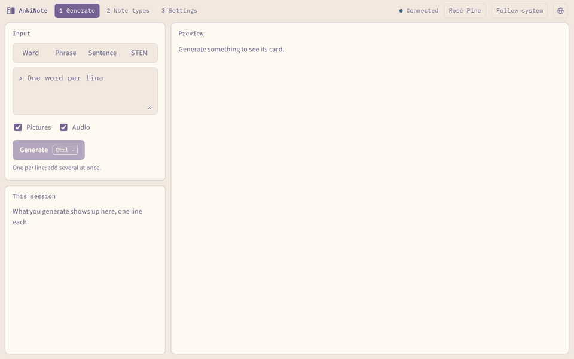
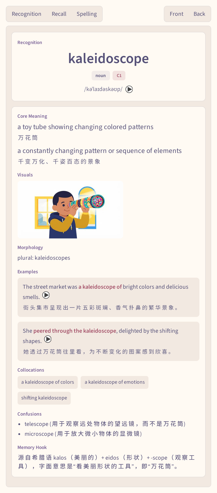
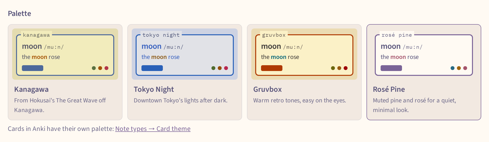
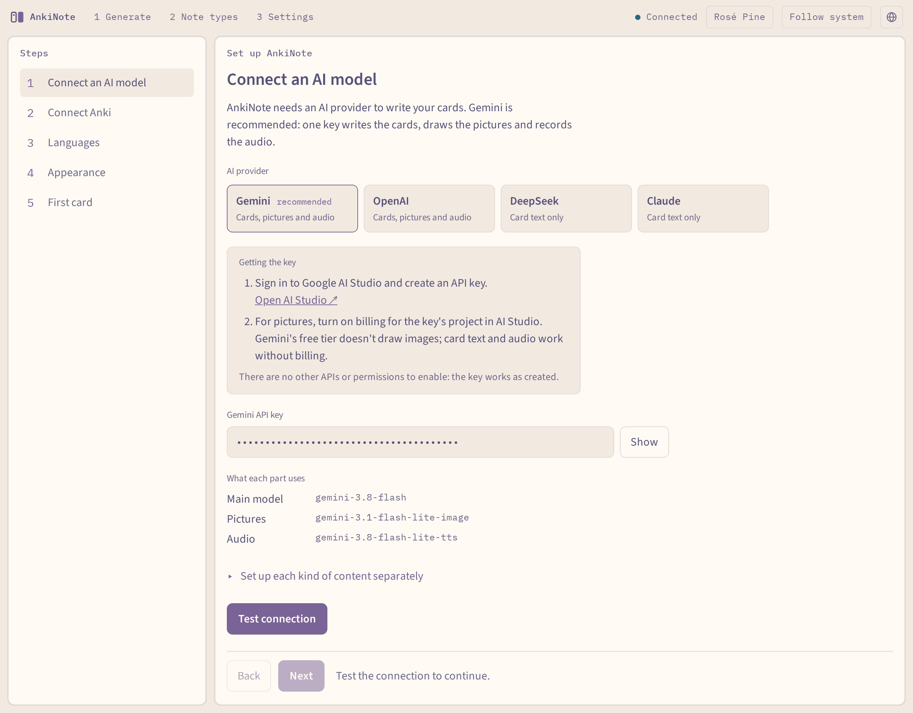
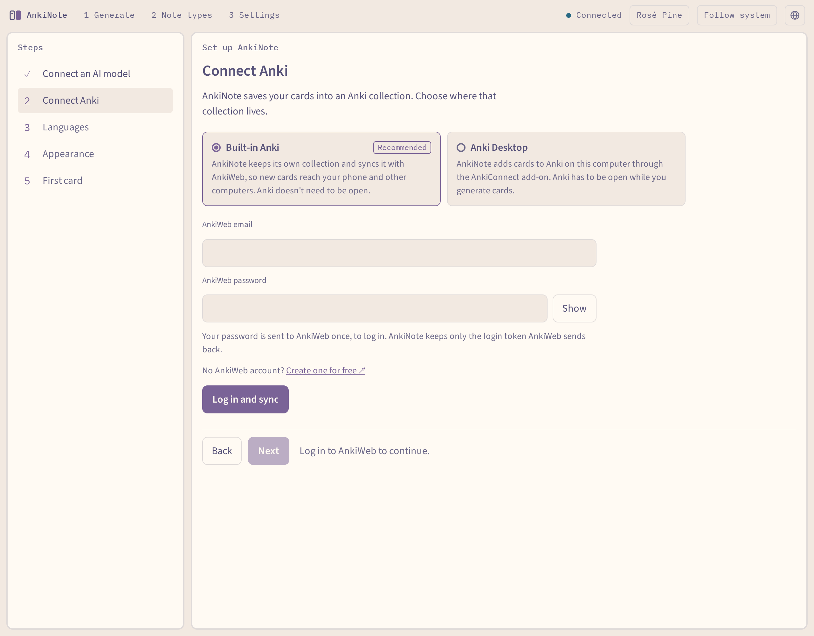

# AnkiNote

<p align="center">
  <picture>
    <source media="(prefers-color-scheme: dark)" srcset="docs/brand/mark-dark.svg">
    
  </picture>
</p>

<p align="center">
  <strong>輸入一個單字、句子或 STEM 題目，幾秒鐘就能生成可直接複習的精美 Anki 卡片。</strong>
</p>

<p align="center">
  <a href="https://pypi.org/project/ankinote-ai/"></a>
  <a href="https://pypi.org/project/ankinote-ai/"></a>
  <a href="https://github.com/ankinote-ai/ankinote/blob/main/LICENSE"></a>
  <a href="https://codecov.io/gh/ankinote-ai/ankinote"></a>
</p>

<p align="center">
  <a href="README.md">English</a> | <a href="README.zh-CN.md">简体中文</a> | <strong>繁體中文</strong> | <a href="README.ja.md">日本語</a> | <a href="README.es.md">Español</a> | <a href="README.fr.md">Français</a>
</p>

---

<p align="center">
  
</p>

製卡不該比背卡還累。**AnkiNote** 是一款由 AI 驅動的 Anki 製卡工作台，只要輸入一個單字、片語、句子或理工科（STEM）題目，就能自動生成包含釋義、例句、記憶技巧、AI 插圖與自然語音的精美卡片，並直接存進你的 Anki。

告別手動排版，告別在 ChatGPT 和 Anki 之間反覆複製貼上。使用自己的 API 金鑰，隨時隨地執行，在手機、平板和電腦上無縫複習。

---

## ✨ 核心亮點

- **搭配你現有的 Anki** — 在你平常學習的電腦上，卡片透過 AnkiConnect 附加元件直接存進 Anki 桌面版：不會多出一份收藏庫，不必先下載，Anki 照常同步。在常開的家用伺服器或 NAS 上，AnkiNote 也能用內建的 Anki 直接同步 AnkiWeb，電腦關著也能用手機瀏覽器新增卡片。
- **一組金鑰完成全部設定** — 首次啟動提供 5 步設定精靈：只要貼上一組 Gemini AI Studio 金鑰，就能同時驅動文字、插圖和語音合成；也支援自由搭配 OpenAI、Claude、DeepSeek、fal.ai、Google Cloud TTS 及任何 OpenAI 相容介面。
- **四種製卡模式：單字、片語、句子與 STEM**
  - **語言學習**：自動生成精準釋義、道地例句、記憶技巧、AI 情境插圖與擬真發音。支援 **英語、法語、西班牙語、德語、日語、中文（簡／繁體，附注音／拼音）與韓語（Beta）** 任意互相學習。
  - **STEM 理科解題**：輸入題目或**直接上傳題目截圖／照片**，生成結構化的逐步解析卡片，原生支援 MathJax 公式算繪與輔助示意圖。
- **即時預覽、行內編輯與 AI 改寫** — 儲存前可隨時翻轉正反面、切換深色／淺色主題。可直接修改任何欄位，也能讓 AI 依指示重寫 STEM 解析，或一鍵修復有誤的 LaTeX 公式（可復原）。
- **精選卡片配色主題** — 內建 **Rosé Pine**、**Kanagawa**、**Tokyo Night**、**Gruvbox** 四套配色（皆含淺色與深色模式），桌面版與行動版 Anki 都能自動適應。
- **可以交給 AI Agent** — 有了 `ankinote` 命令列工具，Claude Code、Codex 等能執行指令的 Agent 就能把你正在讀的內容做成卡片。

---

## 📸 卡片與介面展示

<table>
  <tr>
    <td width="50%" valign="top" align="center"><br><sub>語言卡片：釋義、插圖與例句</sub></td>
    <td width="50%" valign="top" align="center"><br><sub>STEM 卡片：公式與逐步解析</sub></td>
  </tr>
</table>

<p align="center">
  <picture>
    <source media="(prefers-color-scheme: dark)" srcset="docs/img/themes-dark.png">
    
  </picture>
</p>

---

## 🧭 大家怎麼用

### 在遇到生字的句子裡學它

讀文章或小說時碰到不認識的字？把整句貼到 「生成」頁面，用方括號括住這個字（片語就括住它的每個部分）：

```text
We sat on the [bank] of the river.
I'll [pick] you [up] at six.
```

- **只講這一個意思，不堆釋義。** 卡片只講句子裡用到的那個義項：這裡的 "bank" 是河岸，而不是字典裡列出的所有意思。多義字和片語動詞都不會雜亂。
- **你讀到的句子就是第一個例句。** 原句一字不改地留在卡片上，複習時回到當初遇見它的地方，有語境更容易記住。
- **任何詞形、任何語言。** 括住你看到的形式即可（`ran`、`食べた`，或德語 `Ich [rufe] dich [an]` 裡分開的兩部分），卡片會給出字典原形。

不帶括號的一行就是單字本身，所以單字和句子可以放在同一批裡。

### 把做錯的題變成卡片

作業或考古題裡有道數學、物理題做錯了？拍張照片，在 「生成」頁面切到 **STEM**，把圖片貼上或拖進去，不用手動輸入題目。卡片類型選 **題目**，或者保持 **自動**：

- **就是你做錯的那道題。** 正面是這道題，整理成不看圖片也能讀懂的完整題目，背面是最終答案。你複習的是自己真正錯過的題，而不是課本裡隨便挑的一道。
- **完整解法，以及怎麼想到它。** 分步驟的解題過程，再加幾行說明你自己怎樣能想到這個方法：題目裡指向它的那個線索，往往正是你當時沒注意到的地方。
- **儲存前先檢查。** 預覽會把公式排版出來。用 **編輯欄位** 修改某一步，或對顯示不出來的公式點 **用 AI 修正**，然後儲存到 Anki。

讀圖需要主模型支援圖片輸入；推薦的 Gemini 模型就支援。

---

## 🚀 1 分鐘快速上手

唯一需要事先安裝的是 [uv](https://docs.astral.sh/uv/getting-started/installation/)（它會自動幫你管理 Python 環境）：

```bash
curl -LsSf https://astral.sh/uv/install.sh | sh
```

不用安裝，直接執行：

```bash
uvx --from ankinote-ai ankinote-web
```

在瀏覽器開啟 **<http://127.0.0.1:8000>**。首次啟動時，**設定精靈**會帶你完成：

1. **AI 服務** — 貼上 Gemini API 金鑰（一次涵蓋文字、插圖、語音），或展開**進階選項**設定 OpenAI、Claude、DeepSeek、fal.ai 等。
2. **Anki 連接** — 開啟已安裝 [AnkiConnect](https://ankiweb.net/shared/info/2055492159) 附加元件的 Anki 桌面版，設定精靈會自動找到它並建立筆記類型。*（伺服器上沒有 Anki 桌面版時，選擇**內建 Anki** 並登入 AnkiWeb。）*
3. **語言** — 選擇母語與目標語言。
4. **外觀** — 選擇配色與淺色／深色模式，Anki 卡片也會使用同一套配色。
5. **第一張卡片** — 直接在設定精靈中生成並儲存你的第一張卡片。

<table>
  <tr>
    <td width="50%" valign="top" align="center"><br><sub>設定精靈第 1 步：連接 AI 模型</sub></td>
    <td width="50%" valign="top" align="center"><br><sub>設定精靈第 2 步：連接 Anki</sub></td>
  </tr>
</table>

如果想全域安裝、隨時啟動：

```bash
uv tool install ankinote-ai
ankinote-web
```

> **系統需求**：Linux 需要 `glibc >= 2.35`（Ubuntu 22.04+、Debian 12+ 等）；也支援 macOS 12+ 與 Windows。

---

## 🐳 Docker 自架（NAS／伺服器）

把 AnkiNote 常駐在家用伺服器或 NAS 上，電腦關著也能隨時用手機瀏覽器製卡。在你平常使用 Anki 的電腦上不需要 Docker，上面的快速上手就夠了。Docker Hub 與 GHCR 都有提供多架構映像檔（`amd64` + `arm64`）：`ghcr.io/ankinote-ai/ankinote` 與 `ignity21/ankinote-ai`。

```bash
# 內建 Anki + AnkiWeb 同步，不需要桌面版
cd deploy/headless
cp .env.example .env      # 選用：設定 ANKIWEB_USERNAME / ANKIWEB_PASSWORD、連接埠等
docker compose up -d      # 開啟 http://localhost:8080
```

如果想讓容器改用裝有 AnkiConnect 的 Anki 桌面版，請使用 `deploy/standard`。AnkiNote 沒有登入功能，請只在家用區域網路或 Tailscale 這類私人網路中使用；若要開放到網際網路，必須放在要求登入的反向代理之後。完整部署說明與遷移指南請見 [`deploy/README.md`](deploy/README.md)。

---

## ⌨️ 在終端機裡使用，或交給 AI Agent

`ankinote` 指令不用開瀏覽器就能製卡，和網頁應用程式共用同一份設定。所以任何能執行指令的 AI Agent（Claude Code、Codex 等）都能替你呼叫它。

**從一張拍下來的書頁開始。** 把畫了生字的那一頁拍下來，告訴 Agent：*「把畫線的單字做成 Anki 卡片。」* 它會讀取圖片、挑出單字，然後執行：

```bash
ankinote word batch serendipity ephemeral eloquent
```

**從現成的單字表開始。** 一行一個字：

```bash
ankinote word batch --file words.txt --rpm 30
```

命令列做的卡片不經預覽，直接進入 Anki。想先逐張檢查再儲存，就把同一份清單貼到網頁應用程式的生成頁面。

單獨執行 `ankinote` 會在終端機裡開啟選單。片語、句子、STEM 卡片和所有選項請見 [CLI 使用指南](docs/cli-usage.md)。想讓 Agent 學會這些指令，執行一次 `ankinote skill install`（升級後再執行一次）。

---

## 🤖 支援的模型服務

| 功能 | 內建預設與相容範圍 |
| --- | --- |
| **文字生成** | Gemini、OpenAI、Claude、DeepSeek，或任何 OpenAI 相容介面（基於 `litellm`） |
| **圖片生成** | Gemini、OpenAI（`gpt-image`）、fal.ai |
| **語音合成（TTS）** | Gemini TTS、OpenAI TTS、Google Cloud TTS |

Google Cloud TTS 需要單獨的 Google Cloud 金鑰（只允許 Cloud Text-to-Speech API），而且即使在每月免費額度內，所屬專案也要開啟計費；AI Studio 金鑰僅限呼叫 Gemini API，在這裡無法使用。設定精靈的「依內容分別設定」中列出了詳細步驟。

所有 API 金鑰與設定都只存在你自己的電腦上（`~/.config/ankinote/settings.json`）。

---

## 🛠️ 本機開發

```bash
git clone https://github.com/ankinote-ai/ankinote.git
cd ankinote-ai

uv sync                   # 安裝 Python 相依套件（需 Python 3.14+）
make web-dev              # 啟動 Svelte + Vite 前端開發伺服器
uv run ankinote-web       # 啟動 FastAPI 後端服務

make test                 # 執行 pytest 測試
make format               # 用 ruff 格式化程式碼
make check                # 程式碼檢查與型別檢查（ruff + ty）
```

---

## 📚 相關文件

- [CLI 使用指南](docs/cli-usage.md)
- [Docker 部署指南](deploy/README.md)
- [筆記類型說明](docs/NoteType.org)
- [Agent Skill](src/ankinote/skills/ankinote-cli/SKILL.md) — 搭配 AI 程式設計助手使用 AnkiNote

## 📄 開源授權

MIT License — 詳見 [LICENSE](LICENSE)。
